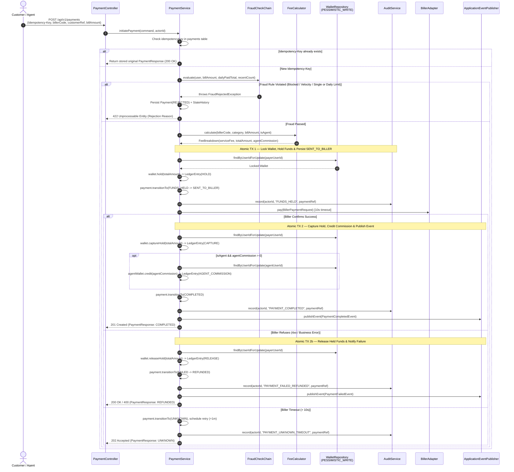
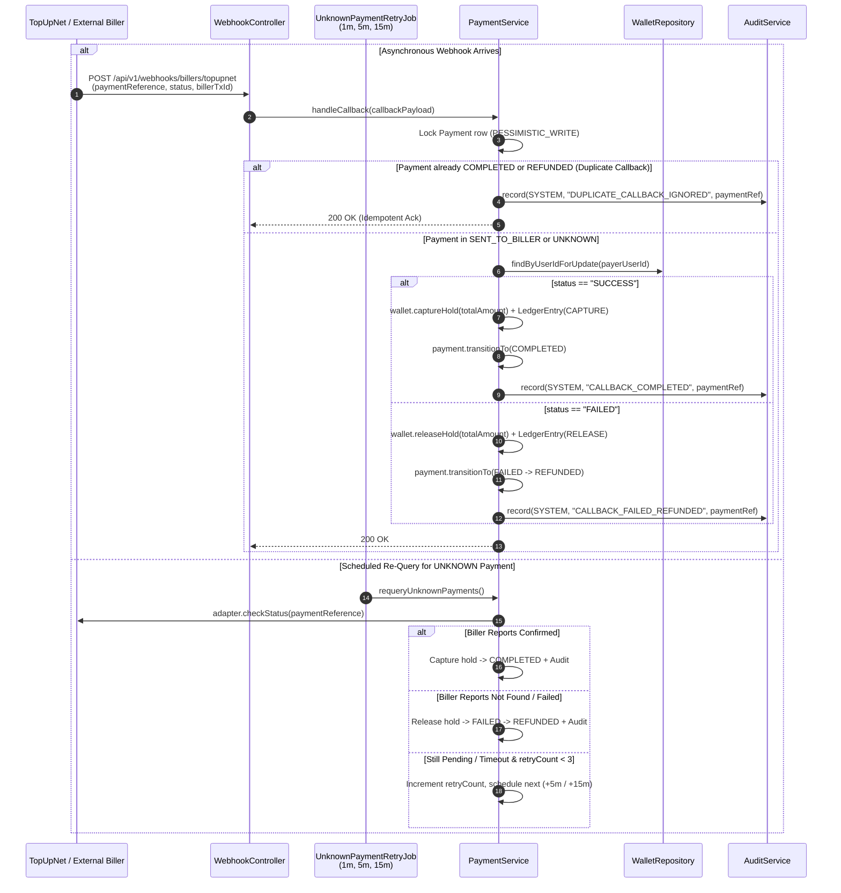
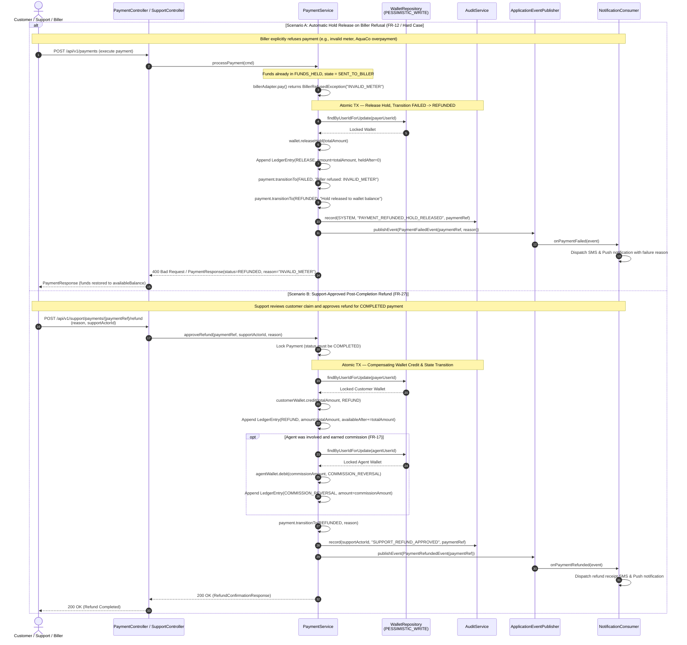

# 03 — Sequence Diagrams

## 3.1 Synchronous Bill Payment Flow (Happy Path + Agent Commission + Audit)

---

## 3.2 Asynchronous Webhook Callback & Timeout Re-Query Flow (TopUpNet / `UNKNOWN`)

---

## 3.3 Refund a Failed Payment Flow (Automatic Hold Release & Support Refund)

