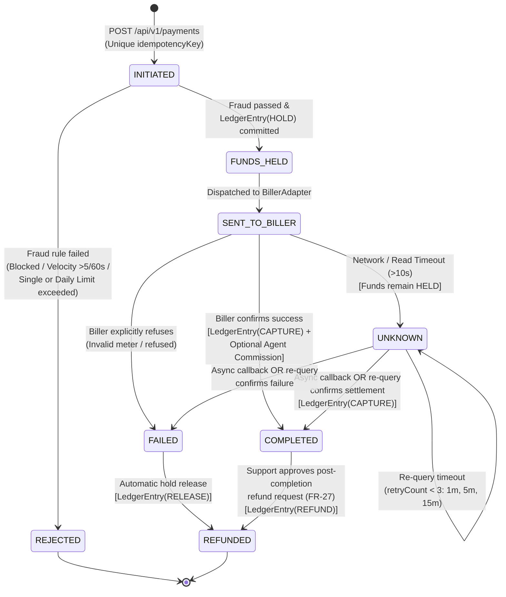

# 04 — Payment State Machine Diagram (`FR-11`)

### State Transition Matrix & Invariants

| From State       | Allowed Next States                              | Ledger Action                                   | Terminal?   |
|:-----------------|:-------------------------------------------------|:------------------------------------------------|:------------|
| `INITIATED`      | `FUNDS_HELD`, `REJECTED`                         | `HOLD` (if `FUNDS_HELD`); none (if `REJECTED`)  | No          |
| `REJECTED`       | *(none)*                                         | None                                            | **Yes**     |
| `FUNDS_HELD`     | `SENT_TO_BILLER`                                 | None (funds already held)                       | No          |
| `SENT_TO_BILLER` | `COMPLETED`, `FAILED`, `UNKNOWN`                 | `CAPTURE` + `AGENT_COMMISSION` (if `COMPLETED`) | No          |
| `UNKNOWN`        | `COMPLETED`, `FAILED`, `UNKNOWN` (max 3 retries) | **Never auto-refunded while `UNKNOWN`**         | No          |
| `FAILED`         | `REFUNDED`                                       | `RELEASE` (heldBalance -> availableBalance)     | No          |
| `COMPLETED`      | `REFUNDED` (only via Support approval `FR-27`)   | `REFUND` (compensating credit)                  | Conditional |
| `REFUNDED`       | *(none)*                                         | None                                            | **Yes**     |